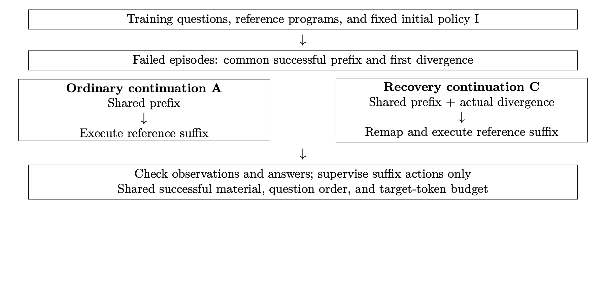

# Dependency-Consistent Recovery Supervision for Executable Knowledge Question Answering with Small Language Models

# Abstract

Small language models performing multi-step knowledge queries must continue solving after their generated histories depart from successful demonstrations. An extra executable action can also change intermediate-result identifiers, making direct reuse of a reference suffix unreliable. We present a dependency-consistent recovery-supervision construction for executable knowledge question answering. A fixed initial model produces unsuccessful training episodes; a shared successful prefix and one actual divergent action are retained; reference dependencies are remapped to current result handles; and execution replay checks the resulting continuation. Training supervises the continuation while preserving the divergent history as context. Using Qwen2.5-3B-Instruct with LoRA, we compare recovery continuation against ordinary continuation with the same initialization, successful examples, question order, and supervised-token budget. On a project-held-out set of 2,000 KQA Pro questions, mean accuracy across two paired continuation seeds increases from 78.75% to 83.50%, a gain of 4.75 percentage points with a question-paired 95% bootstrap interval of $[3.53,5.98]$. Unfinished episodes and invalid calls decrease, and cumulative inference tokens decrease by 8.84% and 4.17% relative to the matched stepwise controls. A separate offline diagnostic of saved training histories identifies dependency mismatches under direct suffix splicing. The results support reference-program-based recovery supervision in deterministic, read-only query environments.

**Keywords:** executable question answering; small language models; recovery supervision; dependency remapping; execution feedback

# Introduction

Executable knowledge question answering connects natural-language questions to explicit operations over a knowledge base. A model may locate an entity, traverse a relation, apply a qualifier, and compare or count the resulting objects. Intermediate outputs therefore serve both as evidence for the next decision and as operands of later operations. Datasets such as KQA Pro provide questions, reference programs, and answers, supporting the study of these compositional procedures \[1\]. Stepwise interaction gives language models access to execution observations \[2\], but it also requires them to manage the history they have actually produced.

Successful demonstrations describe a narrow set of histories. During free execution, a model can make an unnecessary query, obtain an empty result, or repeatedly select an invalid dependency. These histories may differ from the reference even when the next correct query is available. A further issue arises when intermediate outputs receive append-only handles: an extra successful action shifts subsequent physical identifiers. Copying the remaining reference actions without adapting their dependencies can then address the wrong results.

This paper studies how to construct supervision for continuing from such histories when reference programs and a deterministic query executor are available. We retain the first reference-divergent action of an unsuccessful episode, connect the reference suffix to the resulting state through a handle map, and replay the suffix before admitting it as a training target. The divergence remains context; the continuation provides the supervised actions. The central design question is how to preserve the reference dependency structure while training on a history generated by the initial model.

We evaluate the construction with a matched ordinary-continuation control. Both models start from the same checkpoint and receive the same successful material and logical suffix targets. Their paired records differ in whether the actual divergence and its feedback precede the suffix, with dependencies adapted to the respective state. This comparison yields a 4.75-point mean accuracy gain on 2,000 project-held-out questions. Execution-state and cost analyses describe where the aggregate improvement appears, while a separate construction diagnostic examines the consequences of retaining obsolete handle numbers.

Our contributions are: (1) an executable recovery-target construction combining real divergent histories, dependency remapping, and replay checks; (2) a paired supervision protocol that matches target-token exposure while preserving the complete retained histories; and (3) an empirical evaluation connecting answer accuracy, completion, inference cost, and continuation validity. The method is studied in a fixed, read-only environment where prior results remain available and reference operations can be replayed.

# Related Work

#### Learning from visited states.

DAgger addresses the mismatch between expert demonstrations and states visited by a learned policy by aggregating expert actions on policy-generated states \[3\]. This motivates exposing a learner to its own execution histories. Our construction uses a fixed initial policy and existing reference programs to obtain continuations for a selected class of recoverable histories.

#### Corrective trajectory training.

Agent-R constructs revision trajectories from successful and unsuccessful branches explored with Monte Carlo tree search and performs iterative self-training \[4\]. STeP uses teacher-provided reflections and corrections, with partial masking to control which portions become learning targets \[5\]. On-policy expert corrections (OEC) let a student begin a trajectory and an expert continue from an intermediate point, training on the expert continuation after environment-based filtering \[6\]. ReTerm builds recovery supervision by having a stronger teacher continue from failed terminal states and histories, and further studies online recovery rollouts in reinforcement learning \[7\]. These methods share the use of student-generated context followed by improved behavior. Here, existing reference programs supply the continuation, and explicit handle remapping connects their dependency structure to the retained history.

#### Execution and correction objectives.

ReAct organizes reasoning and actions around environment observations \[2\]. Self-Refine and Reflexion use iterative feedback or verbal memory during inference \[8\], \[9\]. SCoRe trains multi-turn self-correction using reinforcement learning \[10\]. Fission-GRPO turns execution errors into recovery instances and resamples recovery trajectories within an RL loop \[11\]. Our main comparison uses supervised continuation targets. The distinctions concern the source of corrective actions, the available execution structure, and the training objective. We compare these designs conceptually; our empirical controls operate on the same knowledge-query task and training protocol. Performance values from different environments are not used as a common leaderboard.

| Method | Continuation source | Construction and supervision |
|:----------|:--------------------------|:-----------------------------|
| DAgger | Expert actions on visited states | Expert labeling and iterative aggregation |
| Agent-R | Search branches and model-guided revision | MCTS outcomes and iterative self-training |
| STeP | Teacher reflections and corrections | Student context with masked erroneous steps |
| OEC | Expert continuation of student history | Environment filtering and continuation loss |
| ReTerm | Teacher recovery from failed terminal histories | Recovery SFT followed by online recovery RL |
| This work | Existing reference-program suffix | Handle remapping, read-only replay, suffix loss |

: Table 1. Recovery-supervision sources and construction requirements.

# Dependency-Consistent Recovery Supervision

## Execution model and retained history

Let $G$ be a fixed knowledge base, $q$ a question, $s_t$ the executor state, and $H_t$ the model-visible history. A query action is $a_t=(f_t,\ell_t,D_t)$, comprising a function, literal arguments, and a list of dependency handles. Execution produces $$(s_{t+1},o_t)=\mathcal{E}(G,s_t,a_t),\qquad
 H_{t+1}=H_t\mathbin{\Vert}(a_t,o_t).$$ Successful queries append intermediate results; rejected actions return feedback without allocating a successful-result handle. A separate submission action selects an answer handle. An empty result can be a legitimate operation output, and episode correctness is evaluated from the submitted answer.

Each training question has a reference program $P^*$ and answer $y^*$. Executing $P^*$ yields reference actions and observations. The initial stepwise model $I$ also generates a free-running episode. We first replay the recorded episode to check its messages, events, and submitted result. For an unsuccessful episode, we identify the longest prefix whose tool names, arguments, and successful execution match the reference. Its length is $k\geq1$; the next actual action and observation form the retained divergence $d=(\hat a_{k+1},\hat o_{k+1})$.

Reference divergence identifies a construction point rather than a semantic error label. Different valid programs may solve the same question. Admission therefore combines the failure of the complete free-running episode with the ability to construct and execute a correct continuation from the retained history.

## Dependency remapping and replay

Let $m(i)$ map reference result $i$ to its corresponding handle in the current episode. Replaying the shared prefix initializes $m$. For each subsequent reference query $a_i^*=(f_i^*,\ell_i^*,D_i^*)$, the transformed action is $$\rho_m(a_i^*)=
 \left(f_i^*,\ell_i^*,[m(j):j\in D_i^*]\right).$$ After the transformed query returns handle $u$, we set $m(i)=u$. The same map transforms the final submission handle. A result produced by the retained divergent action remains in the episode, but it is not assigned as the counterpart of a reference step.

The dependency invariant is that each referenced result is supplied either by the verified common prefix or by an already executed reference-suffix operation. Fixed knowledge, deterministic read-only operators, and preserved intermediate results make this correspondence usable throughout the continuation. The builder checks dependency availability and interface types, executes every transformed action, compares returned observations with the reference after normalizing returned handle identifiers, and validates the final answer. Calls must fit within the episode budget. These checks establish the admitted target's execution and reference consistency.

For example, suppose the shared prefix produces $h_0$, and the reference continuation would project $h_0$ to $h_1$, compare $h_1$ to produce $h_2$, and submit $h_2$. If an additional query already allocated $h_1$, the replayed projection instead produces $h_2$. The subsequent comparison must consume $h_2$, produce $h_3$, and submit $h_3$. Preserving the original numbers would refer to the extra query or an earlier suffix result. Remapping changes these references while retaining the functions and literal query arguments.

{width="95%"}

## Paired records and supervision

For each admitted history, ordinary continuation $A$ resumes directly from the common prefix $H_k$, whereas recovery continuation $C$ retains $d$ before executing the mapped suffix. With $S^*$ denoting the remaining reference operations, including submission, the records are $$\begin{aligned}
 x^A &= (q,H_k,S^*,\mathrm{Done}),\\
 x^C &= (q,H_k,d,\rho_m(S^*),\mathrm{Done}).
\end{aligned}$$ Actual tool observations are interleaved with the suffix actions in both records. The two suffixes share their logical functions, literals, and dependency graph; their physical handle numerals may differ.

Given token sequence $x_{1:L}$, let $w_t$ indicate whether a position contributes to the causal language-modeling loss: $$\mathcal{L}(\theta)=
 -\frac{1}{\sum_x\sum_t w_t}
 \sum_x\sum_t w_t\log p_\theta(x_t\mid x_{<t}).$$ For paired records, question text, the common prefix, the retained divergence, and all tool observations have zero loss weight. Suffix assistant actions and the ending text are supervised. Ordinary successful trajectories, identical across $A$ and $C$, are mixed into the continuation corpus to retain regular query behavior.

The total continuation budget is 788,534 supervised tokens per arm: 394,267 from ordinary successful material and 394,267 from paired suffixes. For pair $i$, the retained target count is the minimum of its two available target counts and the remaining budget. Excess target positions are masked from the tail; input histories stay intact. The resulting arms each contain 5,772 records covering 2,694 distinct questions. The paired portion repeats the 418 distinct pairs to meet the registered budget, with identical question order, repetition counts, and target counts across arms.

#### Construction procedure.

The algorithm can be summarized as follows:

1.  Replay the initial model's training episode and execute its reference program; retain unsuccessful, replay-consistent episodes with a valid reference answer.

2.  Find a nonempty common successful prefix and preserve the first actual reference divergence.

3.  Restore the prefix in two episodes; append the divergence only to the recovery episode and initialize the reference-result maps.

4.  Execute the remaining reference actions using mapped dependencies, checking observations and final answers under the call budget.

5.  Save both records, apply suffix-only supervision, and match their target-token budgets when building the continuation corpora.

All exclusion reasons are recorded. Reference suffixes are used only during offline training-target construction; evaluated models generate their own actions from the question and actual execution observations.

# Experimental Protocol

## Data, construction sample, and controls

We use KQA Pro and its rule-based execution environment \[1\]. The project uses 5,000 training questions, 500 development questions, and 2,000 held-out questions drawn from the official training data. Training and development retain earlier fixed partitions. The newly formed held-out partition excludes all 8,500 previously used question/program groups and separately excludes groups matching the official validation set. Groups join exact question or program duplicates. Exact question and program overlaps across the three project partitions are zero.

The initial model generates 5,000 training episodes. Of 4,998 replay-consistent episodes, 4,339 are correct and 659 are unsuccessful. The builder admits 418 pairs, covering 63.43% of the replay-consistent failures. The other failures include 240 episodes without a common successful prefix and one reference-answer mismatch. Among admitted pairs, 414 retained divergent actions execute successfully and four are rejected. Thus, the training sample primarily represents continuations after executable deviations.

The primary comparison is $A$ versus $C$. Both start from the same $I$ checkpoint and use the matched continuation corpus. We train two continuation seeds, 20261003 and 20261004, sharing $I$, the collected histories, and the corpus. A one-shot program generator $P$ supplies an execution-style and cost reference. It is trained for three epochs on 4,999 admitted program examples, with 273,426 target tokens per epoch. Its supervision differs from the stepwise recipe; the matched $A/C$ contrast isolates the studied continuation treatment more closely.

## Model and inference settings

The backbone is Qwen2.5-3B-Instruct \[12\]. LoRA \[13\] uses rank 16, scaling 32, dropout 0.05, and the implementation's all-linear target selection. Initial stepwise training uses 4,999 successful demonstrations for two epochs, with 788,534 supervised tokens per epoch; one question from the 5,000-question training partition fails reference-execution admission. $A/C$ each receive one continuation pass with the matched target budget. Continuation training uses AdamW, learning rate $10^{-4}$, batch size 2, gradient accumulation 8, BF16, gradient checkpointing, and SDPA attention.

Stepwise evaluation uses greedy decoding, batch size 8, and an 8,192-token context limit. Each question permits at most 24 tool calls, 2,048 generated tokens, and 192 generated tokens per turn. All questions remain in the denominator. The five held-out models, decoding settings, feedback format, estimand, and cost definitions are fixed before answer scoring. Replaying the four stepwise outputs and executing the program baseline reproduces all 10,000 saved results before scoring.

## Metrics and paired estimation

Answer accuracy is the primary task metric. Let $y_{i,s}^M\in\{0,1\}$ denote correctness for question $i$, model $M$, and continuation seed $s$. The registered main effect is $$\widehat\Delta=\frac{100}{N}\sum_{i=1}^{N}
 \frac{(y_{i,1}^{C}-y_{i,1}^{A})+(y_{i,2}^{C}-y_{i,2}^{A})}{2},
 \qquad N=2{,}000.$$ A question-paired percentile bootstrap draws 5,000 resamples, retaining both seeds' outcomes for each selected question. The resulting interval describes question-level uncertainty conditional on the evaluated checkpoints. Completion, invalid calls, and transitions among unfinished, finished-wrong, and correct episodes characterize execution. Inference cost sums each turn's unpadded full input and generated tokens, including EOS; repeated history is counted each time it is presented.

# Results and Analysis

## Held-out question-answering performance

| Model   | Correct | Acc. (%) | $C-A$ | 95% CI         |
|:--------|--------:|---------:|------:|:---------------|
| $P$     |    1523 |    76.15 |    -- | --             |
| $A_{1}$ |    1565 |    78.25 |    -- | --             |
| $C_{1}$ |    1658 |    82.90 | +4.65 | \[3.10, 6.25\] |
| $A_{2}$ |    1585 |    79.25 |    -- | --             |
| $C_{2}$ |    1682 |    84.10 | +4.85 | \[3.35, 6.40\] |
| A mean  |      -- |    78.75 |    -- | --             |
| C mean  |      -- |    83.50 | +4.75 | \[3.53, 5.98\] |

: Table 2. Results on the same 2,000 project-held-out questions. Differences and confidence intervals are in percentage points.

Table 2 shows consistent positive effects across the two continuation seeds. The first pair improves from 78.25% to 82.90%, and the second from 79.25% to 84.10%. The mean gain is 4.75 percentage points, with a 95% interval of $[3.53,5.98]$. The individual gains are 4.65 and 4.85 points, with intervals $[3.10,6.25]$ and $[3.35,6.40]$. Relative to the matched ordinary continuation, the recovery-history construction improves complete question answering under the fixed inference budget.

The first pair corrects 177 questions and regresses on 84, producing 93 additional correct answers. The second corrects 171 and regresses on 74, producing a net gain of 97. Reporting both changes makes the aggregate effect explicit. The one-shot model reaches 76.15%; the two recovery models exceed it by 6.75 and 7.95 points, with the interaction-cost difference examined below.

## Completion and inference cost

| Model   | Unfinished | Invalid | Input (M) | Output (k) | Total (M) |
|:--------|-----------:|--------:|----------:|-----------:|----------:|
| $A_{1}$ |        198 |    3725 |    20.502 |    350.172 |    20.853 |
| $C_{1}$ |         80 |    1268 |    18.646 |    363.771 |    19.010 |
| $A_{2}$ |        205 |    3845 |    20.412 |    328.276 |    20.740 |
| $C_{2}$ |         91 |    1216 |    19.494 |    381.937 |    19.876 |

: Table 3. Execution and cumulative inference cost on the held-out set. Tokens count repeated full histories across turns.

Unfinished questions decrease from 198 to 80 for the first pair and from 205 to 91 for the second. All unfinished episodes exhaust the 24-call limit. Invalid calls decrease from 3,725 to 1,268 and from 3,845 to 1,216, respectively, reductions of 65.96% and 68.37%.

The paired state transitions provide a descriptive decomposition of the accuracy gains. Net transitions between unfinished and correct contribute 72 and 75 questions; net changes between wrong and correct among completed episodes contribute another 21 and 22. Averaged across seeds, 73.5 of the 95 net additional correct answers cross the completion boundary. Some additional completions remain wrong, and some previously correct answers regress. The improvement combines more successful termination with changes in the queries generated within completed episodes.

Relative to $A$, the recovery models reduce cumulative input-plus-generated tokens by 8.84% and 4.17%. The reduction comes from less repeated input processing, while generated tokens increase by 3.88% and 16.35%. The one-shot generator uses 804,096 total inference tokens; the two recovery models use 23.64 and 24.72 times that amount. Recovery continuation therefore improves quality and cumulative token cost relative to the matched stepwise baseline, while the one-shot route remains substantially less costly in this token measure.

## Offline continuation-construction diagnostic

| Construction check               | Direct splice | Remapped |
|:---------------------------------|--------------:|---------:|
| All suffix calls execute         |            65 |      414 |
| Answer submitted                 |           121 |      414 |
| Answer matches reference         |             9 |      414 |
| All reference observations match |             0 |      414 |
| Full construction gate passes    |             0 |      414 |

: Table 4. Offline suffix construction on 414 strictly comparable historical training pairs. Four further pairs remain explicitly unavailable for exact replay within the fixed population of 418.

A separate CPU diagnostic uses all 418 previously admitted pairs. Each variant restores the same saved prefix and actual divergence. Direct splicing retains the original reference handle numbers; mapped execution transforms dependencies; the full builder additionally uses reference-consistency checks for admission. Direct splicing attempts the remaining fixed reference calls after a rejection until termination or the original call limit, without replanning.

Of the fixed 418 pairs, 414 permit exact local comparison. Four rejected-action histories differ only in the wording of Python's `UnboundLocalError` detail; their actions, error class, and rejection status agree. They remain in the recorded population as unavailable for strict comparison. All 414 comparable divergences allocate an additional handle.

Direct splicing completes every suffix call successfully in 65 cases, submits an answer in 121, and matches the reference answer in nine. Mapped execution completes and matches the reference in all 414 comparable cases. Direct splicing has intermediate-dependency mismatches in 348 cases and submission-handle mismatches in 391, with overlap. All nine matching answers still have reference-dependency mismatches and at least one rejected suffix call; five also differ in the type or content of a full internal result. These observations establish why final answer equality alone is insufficient for reconstructing the intended training continuation.

Mapped execution with and without admission filtering produces identical sequences for all 414 comparable pairs, and the gate rejects no additional candidates. This result is consistent with analyzing a historically admitted sample: disabling a check need not create a different training corpus. The diagnostic isolates a construction failure mode and confirms dependency-consistent targets; learning performance is measured separately by the held-out $A/C$ comparison.

## Feedback-text diagnostic

An auxiliary inference-time study replaces detailed error categories and messages with generic failure text, while retaining actual executor state and successful observations. Across the four fixed $A/C$ checkpoints on 500 development questions, accuracy changes by $+0.2$ to $+0.4$ percentage points, with every interval containing zero. This narrow intervention provides no stable evidence that detailed error wording improves performance in that setting. Five trajectories also differed before their first intervention, with the cause unresolved. Most training divergences are executable actions, making the broader interaction history an important object for further behavioral analysis.

# Discussion and Scope

The results connect two complementary forms of evidence. The controlled continuation experiment evaluates a learned policy from the original question and shows a positive held-out increment. The offline construction experiment explains how reference dependencies behave after the retained history changes. Together, they support the usefulness of a verified continuation construction without equating construction success with a model recovery rate.

The present setting has one 3B backbone, one knowledge-query benchmark, and two continuation seeds sharing their initial checkpoint and corpus. The project-held-out split controls exact question/program overlap; entities, relations, and program structures remain shared within the knowledge base. The bootstrap interval conditions on the fixed checkpoints rather than estimating all training variance. Admission covers histories with a common successful prefix and sufficient replay budget, and most selected deviations are executable. The method's state assumptions suit deterministic, read-only queries; tools that modify external state require additional recovery mechanisms.

A registered evaluation from identical normal and divergent histories is prepared but has not yet been run. It will complement the current free-running and construction evidence by controlling the states at which the models resume. The present accuracy gain concerns the complete recovery-supervision recipe; it does not separately identify every contribution of history exposure, handle renumbering, and target filtering.

# Conclusion

We presented dependency-consistent recovery supervision for executable knowledge question answering. Actual unsuccessful histories provide the context, reference programs provide subsequent actions, and handle remapping with replay connects the two. Under matched supervised-token exposure, the approach improves mean accuracy from 78.75% to 83.50% on 2,000 project-held-out KQA Pro questions and reduces unfinished episodes and cumulative inference tokens relative to ordinary stepwise continuation. The construction diagnostic further shows how obsolete handle numbers disrupt reference suffixes, including cases where the final answer happens to match. These findings establish a concrete recovery-training approach for small language models in structured, replayable query environments.

# References

[\[1\] ]{.csl-left-margin}[S. Cao *et al.*, "KQA Pro: A dataset with explicit compositional programs for complex question answering over knowledge base," in *Proceedings of the 60th annual meeting of the association for computational linguistics (volume 1: Long papers)*, Association for Computational Linguistics, 2022, pp. 6101--6119. doi: [10.18653/v1/2022.acl-long.422](https://doi.org/10.18653/v1/2022.acl-long.422).]{.csl-right-inline}

[\[2\] ]{.csl-left-margin}[S. Yao *et al.*, "ReAct: Synergizing reasoning and acting in language models," in *International conference on learning representations*, 2023.]{.csl-right-inline}

[\[3\] ]{.csl-left-margin}[S. Ross, G. Gordon, and D. Bagnell, "A reduction of imitation learning and structured prediction to no-regret online learning," in *Proceedings of the fourteenth international conference on artificial intelligence and statistics*, in Proceedings of machine learning research, vol. 15. PMLR, 2011, pp. 627--635.]{.csl-right-inline}

[\[4\] ]{.csl-left-margin}[S. Yuan, Z. Chen, Z. Xi, J. Ye, Z. Du, and J. Chen, "Agent-R: Training language model agents to reflect via iterative self-training." arXiv:2501.11425, 2025.]{.csl-right-inline}

[\[5\] ]{.csl-left-margin}[Y. Chen, B. Xu, X. Wang, Y. Zhang, and Z. Mao, "Training LLM-based agents with synthetic self-reflected trajectories and partial masking." arXiv:2505.20023, 2025.]{.csl-right-inline}

[\[6\] ]{.csl-left-margin}[N. Lauffer, X. Deng, S. R. Kundurthy, B. Kenstler, and J. Da, "Imitation learning for multi-turn LM agents via on-policy expert corrections," in *Proceedings of the 43rd international conference on machine learning*, in Proceedings of machine learning research, vol. 306. PMLR, 2026, pp. 62884--62913.]{.csl-right-inline}

[\[7\] ]{.csl-left-margin}[W. Xie, K. Feng, S. Fu, Y. Liu, X. Yue, and S. Zheng, "ReTerm: Recovery training for self-improving terminal agents." arXiv:2610.18484, 2026.]{.csl-right-inline}

[\[8\] ]{.csl-left-margin}[A. Madaan *et al.*, "Self-Refine: Iterative refinement with self-feedback," in *Advances in neural information processing systems*, 2023.]{.csl-right-inline}

[\[9\] ]{.csl-left-margin}[N. Shinn, F. Cassano, A. Gopinath, K. Narasimhan, and S. Yao, "Reflexion: Language agents with verbal reinforcement learning," in *Advances in neural information processing systems*, 2023.]{.csl-right-inline}

[\[10\] ]{.csl-left-margin}[A. Kumar *et al.*, "Training language models to self-correct via reinforcement learning," in *International conference on learning representations*, 2025.]{.csl-right-inline}

[\[11\] ]{.csl-left-margin}[Z. Zhang *et al.*, "Robust tool use via Fission-GRPO: Learning to recover from execution errors," in *Proceedings of the 64th annual meeting of the association for computational linguistics (volume 1: Long papers)*, Association for Computational Linguistics, 2026, pp. 40477--40491. doi: [10.18653/v1/2026.acl-long.1880](https://doi.org/10.18653/v1/2026.acl-long.1880).]{.csl-right-inline}

[\[12\] ]{.csl-left-margin}[Qwen Team, "Qwen2.5 technical report," arXiv, 2412.15115, 2024.]{.csl-right-inline}

[\[13\] ]{.csl-left-margin}[E. J. Hu *et al.*, "LoRA: Low-rank adaptation of large language models," in *International conference on learning representations*, 2022.]{.csl-right-inline}
